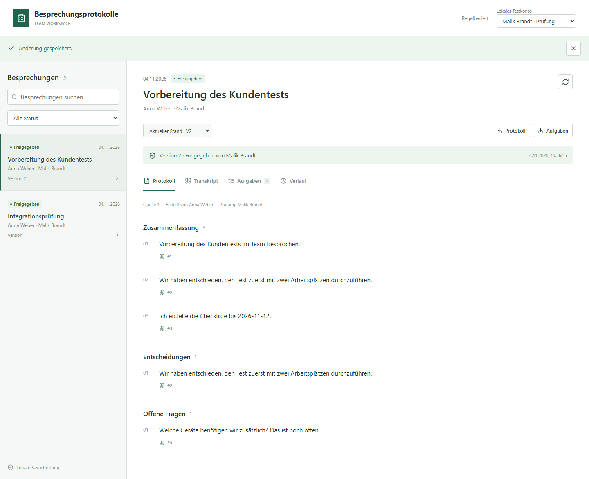
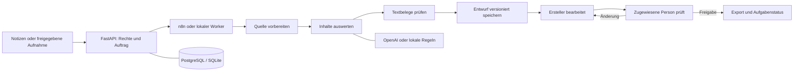

# Besprechungsprotokolle

Eine lokal ausführbare Anwendung für nachvollziehbare Besprechungsergebnisse:
Notizen oder Transkripte erfassen, Entscheidungen und Aufgaben ableiten, Quellen
prüfen und ein Protokoll durch eine zweite Person freigeben.



## Was umgesetzt ist

- Notizen direkt eingeben oder als TXT-Datei importieren.
- Optional eine freigegebene Audioaufnahme transkribieren lassen.
- Zusammenfassung, ausdrücklich beschlossene Ergebnisse, Aufgaben und offene Fragen.
- Nummerierte Quellenstellen mit Textbelegen zu jedem Eintrag.
- Nicht benannte Zuständigkeiten und Fristen bleiben offen.
- Entwürfe bearbeiten, Änderungen anfordern und eine Version freigeben.
- Freigegebene Versionen als Markdown und Aufgaben als CSV exportieren.
- Aufgabenstatus und Bearbeitungshistorie innerhalb der Anwendung nachverfolgen.
- Sichtbarer n8n-Workflow mit getrennten Verarbeitungsschritten; alternativ lokaler Worker.

**Einordnung:** lauffähiger lokaler Prototyp, kein produktionsfertiges
Unternehmenssystem. Die drei frei auswählbaren Testkonten sind keine echte
Identitätsprüfung. Es gibt keine automatische Meeting-Teilnahme, Aufnahme,
Kalenderanbindung oder externen E-Mail-Versand.

## Schnellstart unter Windows

Voraussetzungen: Python 3.12, Node.js 24 und pnpm 11.25.0. Die vorhandene gebündelte
Node-/pnpm-Laufzeit wird vom Skript bei Bedarf erkannt.

```powershell
.\scripts\start-local.ps1
```

Danach [http://localhost:8030](http://localhost:8030) öffnen. Der lokale Start nutzt
SQLite und ruft die Verarbeitungsschritte ohne n8n auf. Ohne API-Konfiguration
läuft ausschließlich eine regelbasierte Demonstration, keine echte KI-Auswertung.
Mit `-Port 8031` kann bei Bedarf ein anderer freier Port gewählt werden.

### Mit echter Auswertung

Die `.env.example` einmal nach `.env` kopieren. Nur lokal eintragen:

```dotenv
PROVIDER=openai
OPENAI_API_KEY=
OPENAI_MODEL=gpt-4.1-mini
TRANSCRIPTION_MODEL=gpt-transcribe
```

Den eigenen Schlüssel hinter `OPENAI_API_KEY=` setzen, nicht in den Quellcode oder
in GitHub. Anwendung anschließend neu starten. Jeder neue externe Auftrag
benötigt in der Erfassung eine ausdrückliche Bestätigung. API-Aufrufe können Kosten
verursachen. Der kostenlose lokale Modus bleibt jederzeit verfügbar.

### Mit PostgreSQL und n8n

Docker Desktop starten und in einer normalen PowerShell ausführen:

```powershell
.\scripts\start-docker.ps1
```

Nicht gleichzeitig mit dem lokalen Start auf demselben Port betreiben.

- Anwendung: [http://localhost:8030](http://localhost:8030)
- n8n: [http://localhost:5680](http://localhost:5680)
- Workflow: **Besprechungsprotokolle - Auswertung und Prüfung**

Das Setup erzeugt lokale Zugangsschlüssel, startet ausschließlich den eigenen
Compose-Stack und importiert den Workflow samt Header-Credential. Beim ersten
Besuch von n8n ein eigenes Konto für diese lokale Instanz anlegen. Es ist nicht
das Konto einer anderen n8n-Installation. In **Executions** sind die einzelnen
Schritte und ihre Daten sichtbar. Die menschliche Prüfung findet anschließend in
der Anwendung statt, nicht im n8n-Editor.

**Prüfstand:** Lokaler Betrieb, Browserablauf und echte Textauswertung wurden
ausgeführt. Der komplette Compose-/n8n-/PostgreSQL-Betrieb konnte in der
Entwicklungsumgebung wegen fehlendem Docker-Engine-Zugriff noch nicht ausgeführt
werden. Der Workflow-Export und seine HTTP-Endpunkte wurden getrennt geprüft.

## Einmal vollständig ausprobieren

1. **Anna Weber** als Erstellerkonto wählen.
2. Eine Besprechung erfassen; über **Beispiel** fiktive Notizen übernehmen.
3. Nach der Verarbeitung die Quellenbelege anklicken und Inhalte prüfen.
4. Optional bearbeiten und anschließend **Zur Prüfung** einreichen.
5. Zum Konto **Malik Brandt** wechseln und die Besprechung öffnen.
6. Änderungen erbitten oder nach eigener Prüfung ausdrücklich freigeben.
7. Protokoll exportieren und im Aufgabenbereich einen Status setzen.
8. Mit **Nora Fischer** prüfen, dass fremde Besprechungen nicht angezeigt werden.

Keine vertraulichen Geschäftsbesprechungen, Zugangsdaten oder fremden Aufnahmen
für eine öffentliche Vorführung verwenden.

## Technischer Aufbau

React / TypeScript · FastAPI / Python · OpenAI Responses API · SQLAlchemy ·
SQLite oder PostgreSQL · n8n · Docker Compose · pytest · Vitest · Playwright.



## Prüfungen

```powershell
.\.venv\Scripts\python.exe -m pip install -r backend/requirements-dev.txt
.\.venv\Scripts\python.exe -m pytest backend/tests -q
.\.venv\Scripts\python.exe -m ruff check backend scripts
```

Im Ordner `frontend`:

```powershell
pnpm test
pnpm build
pnpm exec playwright install chromium
pnpm test:browser
```

Der Browsertest benötigt eine laufende Anwendung im regelbasierten Modus. Bei
einem eigenen Port vorher `APP_URL` setzen. Für den vollständigen Compose-Test:

```powershell
.\.venv\Scripts\python.exe scripts/check_stack.py --require-n8n
```

Ein kostenpflichtiger, ausdrücklich gestarteter API-Test mit ausschließlich
fiktiven Notizen ist separat verfügbar:

```powershell
.\.venv\Scripts\python.exe scripts/check_openai.py --confirm-cost
```

## Dokumentation

- [Fachlicher Ablauf und Abnahmekriterien](docs/konzept.md)
- [Komponenten, Daten und Code nachvollziehen](docs/architektur.md)
- [Ausgeführte Prüfungen und offene Grenzen](docs/pruefungen.md)
- [Sicherheit und Betriebseinschränkungen](SECURITY.md)

Ein GitHub-Push veröffentlicht den Quellcode, nicht die laufende Anwendung. Ein
öffentlicher Live-Betrieb und seine laufenden API-Kosten sind nicht eingerichtet.
